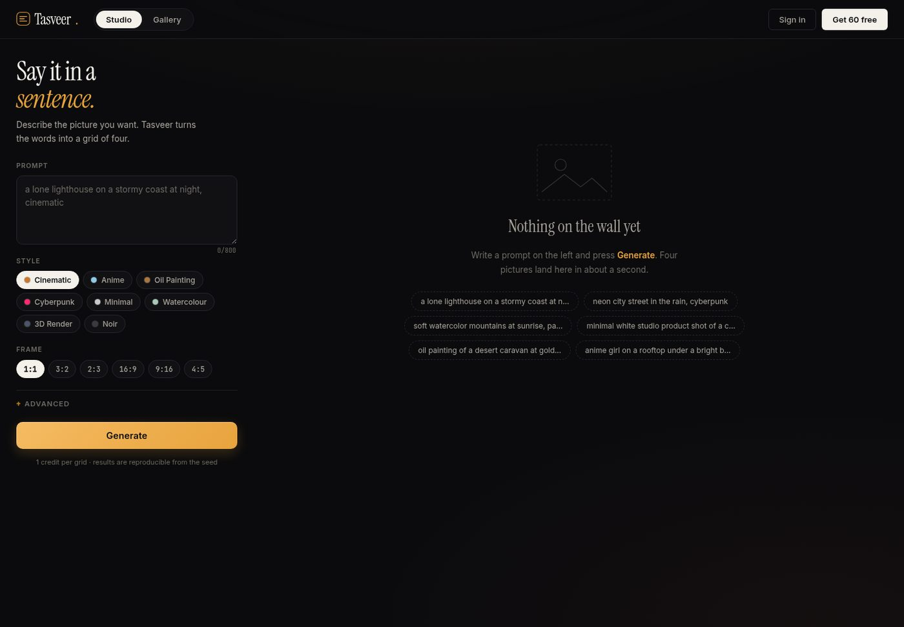
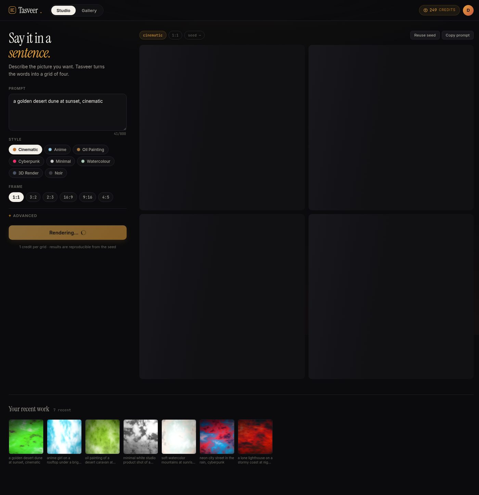
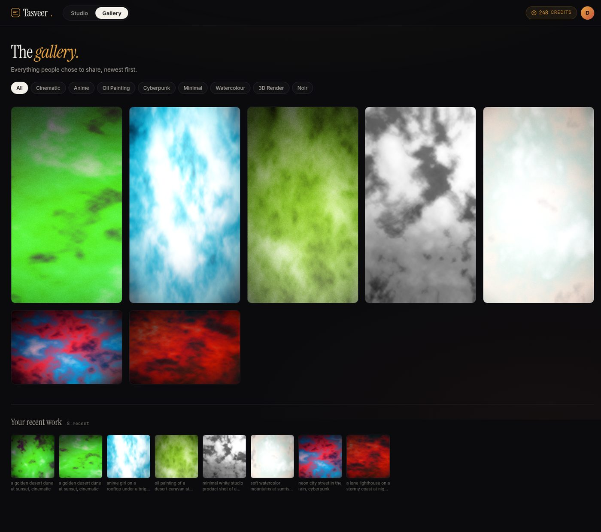
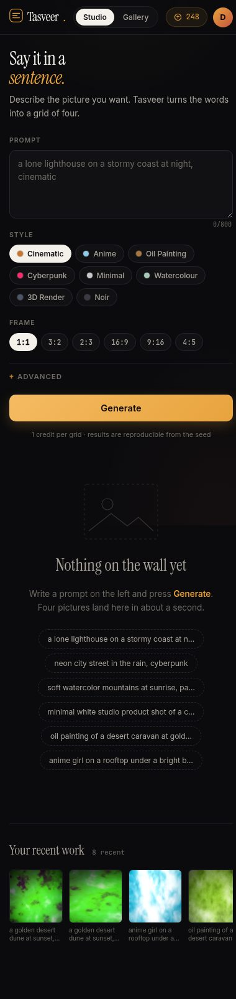

# Tasveer — where a sentence becomes a picture

A Midjourney-style image generation platform. Write a prompt, pick a style, get
a grid of four pictures back in about a second. Reproducible seeds, eight styles,
six aspect ratios, a public gallery, and a real account system with credits.

Built as Day 18 of a 30-day build challenge — one production-ready project a day.



---

## What it actually does

You type something like *"a lone lighthouse on a stormy coast at night,
cinematic"*. Tasveer reads the mood of those words — "night" pulls it dark,
"stormy" pulls it cold and desaturated, "cinematic" picks the amber-and-navy
palette — and renders four variations. Each one has its own seed. Put a seed
back in and you get the exact same picture again.

**One thing to be clear about up front:** the renderer is procedural, not a
diffusion model. It builds images from fractal noise, domain warping and a
palette derived from your prompt. It does not "understand" a lighthouse. It
understands that you asked for something dark, cold and cinematic, and it makes
abstract art in that register.

That is a deliberate choice, and the [architecture doc](ARCHITECTURE.md) explains
why. If you want real generative output, set `IMAGE_PROVIDER=openai` and add a
key — the same API will delegate to a hosted model.

---

## Features

**Generation**
- Prompt + negative prompt, up to 800 / 400 characters
- 8 style presets: cinematic, anime, oil painting, cyberpunk, minimal,
  watercolour, 3D render, noir
- 6 aspect ratios: 1:1, 3:2, 2:3, 16:9, 9:16, 4:5
- 4-image grid per generation, each tile with its own derived seed
- Reproducible: same prompt + same seed = byte-identical PNG
- Auto style detection from prompt keywords when you don't pick one

**Accounts**
- Email + password signup, bcrypt (12 rounds), JWT sessions
- 60 free credits on signup, 1 credit per grid
- Per-user history, delete your own work

**Gallery**
- Public feed of everything people chose to share
- Filter by style, paginated
- Lightbox with download

**Engineering**
- 59 tests, all passing
- ruff clean, ruff-format clean
- Docker + docker-compose (Postgres 16)
- OpenAPI docs at `/docs`
- Rate limiting, security headers, bounded inputs

---

## Screenshots

| Studio | Result grid |
|---|---|
|  |  |

| Gallery | Mobile |
|---|---|
|  |  |

---

## Live demo

**Not deployed yet.** No Vercel token was available in the build environment, so
this runs locally only. The repo is deploy-ready — `vercel.json` and the
serverless entry are in place. See [Deploying](#deploying) below.

To try it right now:

```bash
git clone https://github.com/mohdabrarbaloch-arch/day-18-tasveer
cd day-18-tasveer
pip install -e ".[dev]"
python -m app.seed          # creates demo@tasveer.pk / tasveer123 + 6 gallery pieces
uvicorn app.main:app --reload
```

Open <http://127.0.0.1:8000>. Sign in with `demo@tasveer.pk` / `tasveer123`, or
register your own account and get 60 credits.

---

## Installation

**Requirements:** Python 3.11+, and nothing else. No GPU, no API key, no external
services.

```bash
# 1. clone
git clone https://github.com/mohdabrarbaloch-arch/day-18-tasveer
cd day-18-tasveer

# 2. virtualenv
python -m venv .venv
source .venv/bin/activate        # Windows: .venv\Scripts\activate

# 3. install
pip install -e ".[dev]"

# 4. configure (optional — the defaults work)
cp .env.example .env

# 5. seed demo data
python -m app.seed

# 6. run
uvicorn app.main:app --reload
```

The app is at <http://127.0.0.1:8000>, the API docs at
<http://127.0.0.1:8000/docs>.

### With Docker

```bash
docker compose up --build
```

That brings up the app on port 8000 and Postgres 16 on 5432. The app reads
`DATABASE_URL` from the compose file, so it uses Postgres rather than SQLite.

---

## Usage

### The studio

1. Type a prompt. The counter under the box tracks your 800 characters.
2. Pick a style — or leave it and let the prompt decide.
3. Pick a frame. 9:16 for a phone wallpaper, 16:9 for a header image.
4. Hit **Generate**. Four pictures land in about a second.
5. Hover a tile for its seed and a save button. Click it to open the lightbox.

### Seeds

Every generation has a seed, and every tile within it has a derived seed. Put a
seed in the Advanced panel and you get that exact image back. This is how you
iterate: find a composition you like, then change one word in the prompt and
keep the seed.

### The API

```bash
# register
curl -X POST http://127.0.0.1:8000/api/auth/register \
  -H 'Content-Type: application/json' \
  -d '{"email":"you@example.com","display_name":"You","password":"secret123"}'

# generate
curl -X POST http://127.0.0.1:8000/api/generations \
  -H "Authorization: Bearer $TOKEN" \
  -H 'Content-Type: application/json' \
  -d '{"prompt":"a quiet harbour at dawn","style":"watercolor","aspect_ratio":"16:9"}'
```

Full reference: [docs/api.md](docs/api.md).

---

## Project layout

```
day-18-tasveer/
├── app/
│   ├── main.py              FastAPI app, middleware, static mounts
│   ├── config.py            settings from env, safe dev defaults
│   ├── database.py          engine, session, init_db
│   ├── models.py            User, Generation, Image
│   ├── schemas.py           bounded Pydantic contracts
│   ├── security.py          bcrypt + JWT
│   ├── deps.py              current-user resolution
│   ├── seed.py              demo account + 6 gallery pieces
│   ├── engine/
│   │   ├── prompt.py        prompt → PromptPlan (mood, composition, density)
│   │   ├── styles.py        8 style presets
│   │   └── renderer.py      fBm + domain warp → PNG
│   ├── routers/
│   │   ├── auth.py          register, login, me
│   │   ├── generations.py   create, list, get, delete, stats
│   │   └── gallery.py       public feed
│   └── services/
│       └── limiter.py       SlowAPI instance
├── static/                  index.html, styles.css, app.js
├── tests/                   59 tests
├── docs/                    setup, usage, api, screenshots
├── ARCHITECTURE.md
├── Dockerfile
├── docker-compose.yml
└── pyproject.toml
```

---

## Testing

```bash
pytest              # 59 tests
ruff check .        # lint
ruff format --check .
```

The suite covers the prompt analyser (mood shifts, composition detection, digest
stability), the renderer (determinism, distinct tiles, non-flat output), and the
API (auth boundaries, credit accounting, 404-vs-403 semantics, gallery
visibility, security headers).

---

## Deploying

The repo ships with `vercel.json` and `api/index.py`. To go live:

```bash
npm i -g vercel
vercel --prod
```

Set these environment variables in the Vercel dashboard:

| Variable | Value |
|---|---|
| `SECRET_KEY` | a long random string — **not** the dev default |
| `ENVIRONMENT` | `production` |
| `DATABASE_URL` | a Postgres DSN (Neon, Supabase, RDS) |
| `CORS_ORIGINS` | your domain |

**One caveat:** Vercel's filesystem is read-only and ephemeral. Generated images
written to `storage/generated/` will not persist between invocations. For a real
deployment, swap the storage layer for S3 or R2 — the `Image.filename` column
already stores a relative path, so the change is contained to the URL builder in
`app/routers/generations.py`.

---

## License

MIT — see [LICENSE](LICENSE).

---

Built by [ABraz Baloch](https://github.com/mohdabrarbaloch-arch). Day 18 of 30.
